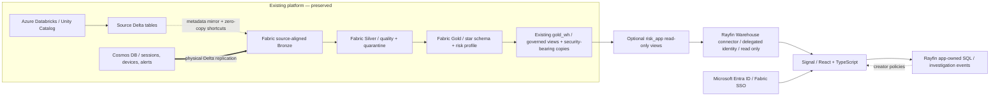

# Architecture and decisions

## Existing platform, additive app

The selected repository already integrates Databricks transaction/risk/merchant Delta data and Cosmos digital behavior, conforms both in Fabric Silver, and builds a Fabric Gold star schema. The app extends that design. It does not introduce a Databricks Gold layer or move existing transformations.

See [the standalone customer diagram](architecture.svg).

## Integration choice

| Option | Assessment for this repository |
|---|---|
| Existing Unity Catalog mirroring + OneLake shortcuts | Preserve it. It exposes source Delta without copying those files; it is not a second Databricks data store. |
| New standalone shortcuts | Redundant with the existing mirrored-catalog path. No new shortcut setup is necessary for the app. |
| Gold Lakehouse SQL endpoint | Supported read-only Rayfin connector. Viable, but the repository documents a OneLake/SQL delegated-identity security enforcement gap. Do not assume configured OneLake CLS protects this endpoint. |
| Existing Gold Warehouse | **Chosen.** It already has SQL serving objects and native customer-risk RLS. An explicit delegated Warehouse connector preserves caller source authorization. |
| New Warehouse or semantic model | Extra lifecycle/deployment work without a POC requirement. No new analytical copy or semantic model is introduced. |

The five `risk_app` views are projections/joins, not copied tables. The three security-bearing local Warehouse copies already exist in the original design; the extension does not create new copies of Gold. Every detail view joins `dbo.AggCustomerRiskProfile`, so the existing profile RLS participates in customer evidence reads. The optional views have stable natural customer identifiers and retain server-side joins on bigint surrogate keys; those keys never pass through JavaScript numbers.

## Source and app data contracts

`CustomerProfile` projects the existing `AggCustomerRiskProfile`: CustomerID, transaction count and unconverted amount, average/high-risk transaction metrics, failed attempts, distinct/untrusted devices, geographic observations, alert count, score/band, Gold timestamp and pipeline run.

`CustomerTransaction`, `CustomerSession` and `CustomerAlert` project the corresponding fact objects after joining the permitted profile. Nullable risk scores/transaction references remain null. Timestamp projections are UTC ISO strings. `QualityCheck` selects the most recently logged reconciliation run; no generic pipeline-success status is substituted for individual checks.

Models declare **no primary keys** for connector views. Field selection, first-row bounds, order and customer filters are explicit. Live overview loads at most 200 customers by default, sorted by score; it is a prioritized cohort, not a random sample or portfolio-wide aggregate. The limit is configurable from 1–1,000. Search and all overview KPIs are labeled as cohort-scoped. Detail queries retrieve at most 50 rows per evidence type. Saved cases outside that cohort reopen through an exact customer query, subject to current source permissions.

## Workflow persistence

`InvestigationEvent` is a separate Rayfin entity in the app-owned SQL database. Fields: UUID event/case IDs, CustomerID, creator subject, event type, status, assignment label, note and timestamp. Policies allow authenticated **create/read only**, with `claims.sub == user_id`. No Gold mutation or event update/delete permission exists. Notes and state changes append events; the client reconstructs the latest case state. Note-only events do not overwrite status or assignment.

This preserves parallel notes, but is not transactional case locking. Concurrent state changes resolve by timestamp then UUID. Client-supplied timestamps are not a tamper-proof audit clock. Production collaboration would need membership-aware server authorization, server timestamps and conflict handling; it must not be implemented as an unrestricted authenticated-users policy.

Demo mode implements the same repository contract with deterministic fixtures and browser IndexedDB. Its persona is explicitly synthetic and is not represented as Entra authentication. Live initialization requires trusted HTTPS configuration and Fabric SSO. Embedded handoff initializes before reading a session; standalone sign-in starts from a user gesture. Sessions stay in memory.

## Freshness and quality

Gold freshness uses actual row load timestamps, not HTTP fetch time. Missing/future timestamps are Unknown. The 24-hour indicator is a POC display threshold, not an SLA. Transactions and sessions retain the existing independent source-relative windows. Non-US sessions are geographic observations, not proven anomalous travel. The app displays the stored risk score and explains the original formula; it does not rescore customers.

Quality checks must refer to the same run as the loaded cohort to receive a passing cohort indicator. Missing evidence, failed queries, mixed runs and stale timestamps remain visible. Demo checks are fixture evidence only. No production source-health monitoring is claimed.
